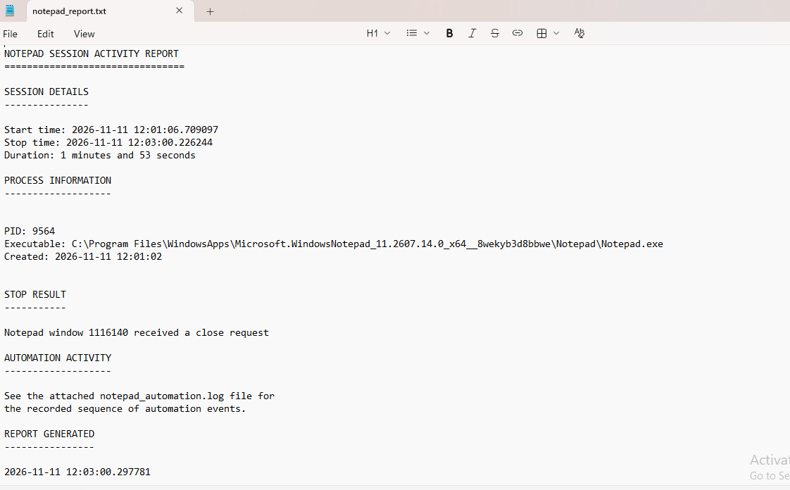
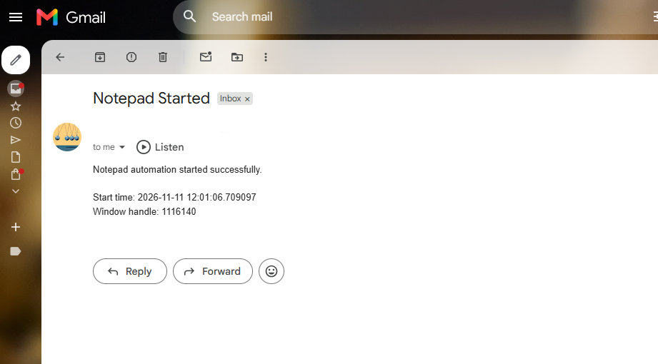
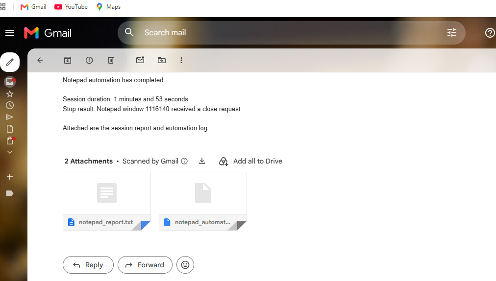
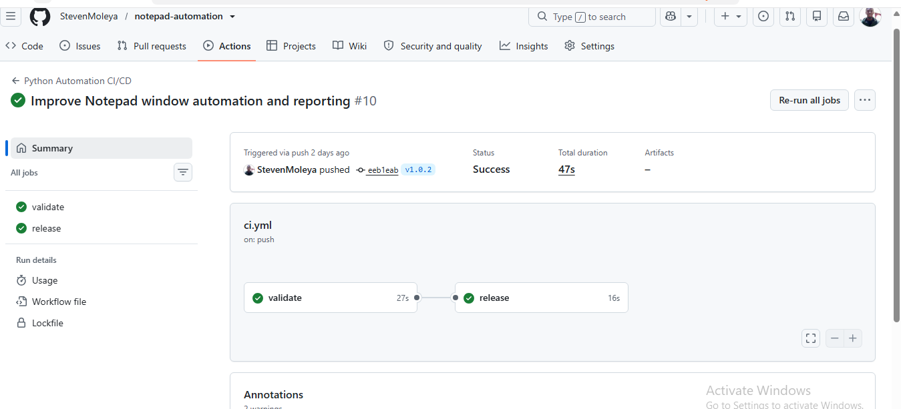

# Python Notepad Automation with CI/CD

A Windows-based desktop automation application developed using Python. The application automates Notepad startup and shutdown, identifies and manages specific Notepad windows, sends email notifications, records execution activities, and generates session reports.

The project also demonstrates automated testing, version control, and CI/CD implementation using GitHub Actions.

## Features

- **Desktop Automation:** Automatically launches and closes Notepad at configured times.
- **Window Management:** Identifies individual Notepad windows using Windows handles (HWND), allowing the automation to target its own window.
- **Task Scheduling:** Supports automated execution through Windows Task Scheduler.
- **Email Notifications:** Sends Gmail notifications when automation starts and stops.
- **Process Monitoring:** Uses `psutil` to retrieve running Notepad process information.
- **Logging:** Records automation events, timestamps, and execution details.
- **Report Generation:** Generates session reports containing execution times, duration, and process information.
- **Email Attachments:** Attaches generated reports and log files to notification emails.
- **Automated Testing:** Uses pytest to validate email notification functionality.
- **Continuous Integration:** GitHub Actions validates Python syntax and runs automated tests.
- **Continuous Delivery:** Automatically packages the application and publishes GitHub releases.

## Project Screenshots

### Notepad Automation Report



### Start Email Notification



### Completion Email Notification



### GitHub Actions CI/CD



## Technologies Used

| Technology             | Purpose                           |
| ---------------------- | --------------------------------- |
| Python                 | Automation and scripting          |
| PowerShell             | Windows command-line operations   |
| Windows Task Scheduler | Scheduled application execution   |
| psutil                 | Process monitoring                |
| pywin32                | Windows API and window management |
| SMTP                   | Email notifications               |
| python-dotenv          | Environment variable management   |
| pytest                 | Automated testing                 |
| Git                    | Version control                   |
| GitHub Actions         | CI/CD automation                  |

## Project Structure

```text
notepad-automation/
│
├── .github/
│   └── workflows/
│       └── ci.yml
│
├── test/
│   └── test_email_notification.py
│
├── email_notification.py
├── notepad_report.py
├── notepad_automation.py
├── requirements.txt
├── .env.example
├── .gitignore
└── README.md
```

## Installation

### 1. Clone the repository

```bash
git clone https://github.com/StevenMoleya/notepad-automation.git
```

### 2. Navigate to the project directory

```bash
cd notepad-automation
```

### 3. Install dependencies

```bash
python -m pip install -r requirements.txt
```

### Prerequisites

- Windows operating system.
- Python 3.12 or compatible version.
- Git.
- Gmail account with an App Password for email notifications.

## Configuration

Create a `.env` file in the project directory using `.env.example` as a template.

In PowerShell:

```powershell
Copy-Item .env.example .env
```

Configure the following environment variables:

```env
GMAIL_ADDRESS=your_email@gmail.com
GMAIL_APP_PASSWORD=your_app_password
NOTIFICATION_EMAIL=recipient@gmail.com

START_TIME=08:15
STOP_TIME=08:20
```

**Security:** Use a Gmail App Password rather than your normal Gmail password. Never upload your `.env` file or email credentials to GitHub.

## Running the Automation

Run the main automation application:

```bash
python notepad_report.py
```

The application continuously monitors the configured schedule.

At the specified start time, it launches Notepad and sends a notification email.

At the configured stop time, it requests closure of the specific Notepad window created by the automation, generates a session report, and emails the report and execution log as attachments.

### Windows Task Scheduler

The application can also be configured to run automatically through Windows Task Scheduler.

This allows the automation to execute independently of the VS Code terminal.

## Running Automated Tests

Execute the test suite:

```bash
python -m pytest -v
```

The current test suite validates email notification functionality, including missing credentials, successful SMTP simulation, missing attachments, and SMTP authentication failures.

The SMTP success test uses a simulated connection and does not send a real email.

## CI/CD Pipeline

The project uses GitHub Actions to automate code validation and release publishing.

### Continuous Integration (CI)

Triggered by:

- Pushes to the `main` branch.
- Pull requests targeting `main`.

The validation pipeline:

1. Checks out the repository.
2. Sets up Python.
3. Installs project dependencies.
4. Compiles Python files to check syntax.
5. Executes automated pytest tests.

### Continuous Delivery (CD)

Triggered when a version tag beginning with `v` is pushed.

The release workflow:

1. Runs the validation job.
2. Packages the application files into a ZIP archive.
3. Publishes a GitHub release containing the packaged application.

Example:

```bash
git tag v1.0.3
git push origin v1.0.3
```

## Releases

The project has the following published versions:

- v1.0.0
- v1.0.1
- v1.0.2

**Latest release:** v1.0.2

[View GitHub Releases](https://github.com/StevenMoleya/notepad-automation/releases)

## Future Improvements

- Expand automated test coverage for Notepad window management.
- Improve exception handling and recovery mechanisms.
- Introduce additional Windows automation functionality.
- Improve reporting and application configuration.

## Author

**Steven Moleya**

- [GitHub](https://github.com/StevenMoleya)
- [LinkedIn](https://linkedin.com/in/steven-moleya)
